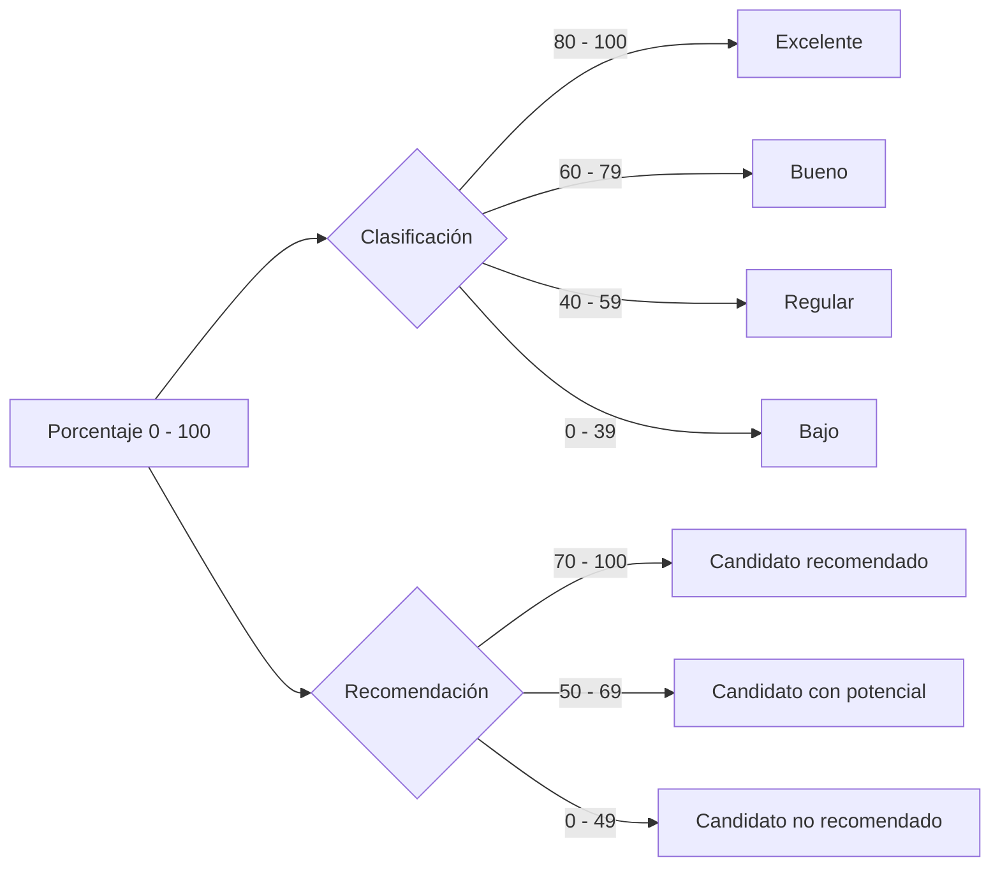

<div align="center">

# 📄 Analizador de CV con IA (CV Analyzer)

### *Evaluación inteligente, estructurada y ética de currículums frente a perfiles de vacantes con Google Gemini*

[](https://www.python.org/)
[](https://streamlit.io/)
[](https://aistudio.google.com/)
[](https://www.langchain.com/)
[](https://docs.pydantic.dev/)
[](https://www.docker.com/)
[](https://astral.sh/ruff)
[](https://docs.pytest.org/)

<p align="center">
  <b>Una solución profesional desarrollada con arquitectura limpia, esquemas estructurados Pydantic y defensas robustas contra inyecciones de prompt.</b>
</p>

</div>

---

<details>
<summary>📑 <b>Tabla de Contenidos</b> (Haz clic aquí para desplegar)</summary>

1. [Acerca del Proyecto](#-acerca-del-proyecto)
2. [Construido con](#-construido-con)
3. [Arquitectura del Sistema](#-arquitectura-del-sistema)
4. [Criterios de Evaluación y Ponderaciones](#-criterios-de-evaluación-y-ponderaciones)
5. [Prerrequisitos](#-prerrequisitos)
6. [Instalación](#-instalación)
   - [Configuración de Variables de Entorno](#1-configuración-de-variables-de-entorno)
   - [Instalación y Ejecución Local](#2-instalación-y-ejecución-local)
   - [Ejecución con Docker y Docker Compose](#3-ejecución-con-docker-y-docker-compose)
7. [Uso y Características](#-uso-y-características)
8. [Pruebas](#-pruebas)
9. [Seguridad y Privacidad](#-seguridad-y-privacidad)
10. [Solución de Problemas](#-solución-de-problemas)
11. [Hoja de Ruta (Roadmap con checkboxes)](#-hoja-de-ruta-roadmap)
12. [Contacto](#-contacto)

</details>

---

## 🎯 Acerca del Proyecto

**CV Analyzer** es una aplicación web interactiva desarrollada con **Streamlit** y potenciada por modelos de lenguaje de última generación (**Google Gemini**) a través de **LangChain**. Su propósito es asistir a equipos de reclutamiento y selección en la comparación exhaustiva, objetiva y trazable entre un currículum vitae en formato **PDF** y la descripción detallada de una vacante laboral.

> [!IMPORTANT]
> **Aviso ético y de responsabilidad:** Las evaluaciones y métricas generadas por este sistema tienen carácter **orientativo** y de apoyo a la decisión humana. **No constituyen una decisión automática ni vinculante de contratación.**

### 🌟 Puntos Clave de la Solución
- **Validación robusta en memoria:** Procesamiento seguro de PDFs sin almacenamiento temporal en disco ni base de datos, previniendo fuga de datos sensibles.
- **Salida estructurada garantizada:** Uso del motor nativo `json_schema` con modelos **Pydantic V2** para garantizar contratos de datos estrictos (`AnalisisCV`).
- **Defensas Anti-Jailbreak:** Delimitadores de seguridad `<cv_no_confiable>` y `<vacante_no_confiable>` que instruyen al modelo a ignorar directivas maliciosas incrustadas en los documentos.
- **Evaluación objetiva e inclusiva:** Se descartan explícitamente atributos demográficos o irrelevantes (edad, género, foto, estado civil, nacionalidad, creencias).
- **Exportación local instantánea:** Descarga directa del dictamen estructurado en formato **JSON** estándar.

[Volver al inicio](#-analizador-de-cv-con-ia-cv-analyzer)

---

## 🛠️ Construido con

El proyecto integra tecnologías modernas del ecosistema de Python y contenedorización:

- 🐍 **[Python 3.12+](https://www.python.org/):** Núcleo del lenguaje tipado y optimizado.
- 🎈 **[Streamlit](https://streamlit.io/):** Framework web reactivo de alta velocidad para prototipado y aplicaciones de datos.
- 🦜🔗 **[LangChain Core](https://python.langchain.com/):** Orquestación de cadenas y pipelines declarativos (`Runnable`).
- 🤖 **[langchain-google-genai](https://github.com/langchain-ai/langchain-google):** Integración nativa oficial con la API de Google Gemini.
- 📐 **[Pydantic V2](https://docs.pydantic.dev/):** Validación estricta y definición del esquema tipado.
- 📄 **[pypdf](https://pypdf.readthedocs.io/):** Inspección y extracción rápida de texto en memoria.
- 🐳 **[Docker](https://www.docker.com/) & [Docker Compose](https://docs.docker.com/compose/):** Contenedorización segura y despliegue reproducible sin privilegios de root (`appuser`).
- 🧪 **[pytest](https://docs.pytest.org/) & [pytest-cov](https://pytest-cov.readthedocs.io/):** Suite integral de pruebas unitarias y cobertura sin consumo de cuota real.
- ⚡ **[Ruff](https://astral.sh/ruff):** Linter y formateador ultrarrápido para código Python de estándar industrial.

[Volver al inicio](#-analizador-de-cv-con-ia-cv-analyzer)

---

## 🏛️ Arquitectura del Sistema

El proyecto sigue una separación limpia de responsabilidades (Clean Architecture / Layered Pattern), desacoplando la capa de presentación, servicios de dominio, modelos y prompts:

```text
cv-review/
├── .streamlit/
│   └── config.toml                  # Configuración de tema oscuro, servidor y límites de subida
├── app/
│   └── intermedio/
│       └── cv_analyzer/
│           ├── app.py               # Punto de entrada principal para Streamlit
│           ├── README.md            # Documentación técnica específica del paquete
│           ├── models/              # Modelos de datos y esquemas de validación
│           │   ├── __init__.py
│           │   └── cv_model.py      # Esquema Pydantic AnalisisCV y validadores
│           ├── prompts/             # Ingeniería de prompts y plantillas
│           │   ├── __init__.py
│           │   └── cv_prompts.py    # Prompts de sistema delimitados y protegidos
│           ├── services/            # Servicios de negocio y utilidades
│           │   ├── __init__.py
│           │   ├── config.py        # Carga segura de variables de entorno y SecretStr
│           │   ├── cv_evaluator.py  # Pipeline LangChain, llamada estructurada y manejo de errores
│           │   └── pdf_processor.py # Validación, límites y extracción en memoria de PDF
│           └── ui/                  # Componentes de interfaz de usuario
│               ├── __init__.py
│               ├── presentation.py  # Mapeo determinista de clasificaciones y recomendaciones
│               ├── streamlit_ui.py  # Interfaz gráfica Streamlit y flujo reactivo
│               └── styles.css       # Estilos visuales CSS y accesibilidad
├── tests/                           # Suite de pruebas automatizadas
│   ├── test_config.py               # Pruebas de variables de entorno y configuración
│   ├── test_evaluator.py            # Pruebas de simulación de Gemini, errores y JSON
│   ├── test_model_and_presentation.py# Pruebas de esquemas Pydantic y umbrales
│   ├── test_pdf_processor.py        # Pruebas de validación y extracción de PDFs en memoria
│   ├── test_prompt.py               # Verificación de inmutabilidad de directivas y límites
│   └── test_ui_state.py             # Pruebas de gestión de estado de sesión
├── .dockerignore                    # Exclusiones de construcción de imágenes Docker
├── .env.example                     # Plantilla de variables de entorno (segura)
├── .gitattributes                   # Normalización de saltos de línea LF
├── .gitignore                       # Ignorado estricto de secretos (.env), .venv y temporales
├── compose.yaml                     # Definición de servicio Docker Compose multi-plataforma
├── Dockerfile                       # Construcción multi-etapa con usuario no privilegiado
├── pyproject.toml                   # Configuración de Pytest y reglas de Ruff
├── requirements.txt                 # Dependencias esenciales de producción
├── requirements-dev.txt             # Dependencias complementarias de desarrollo y pruebas
├── TallerCVAnalyzer.md              # Requisitos y especificación original del taller
└── README.md                        # Documentación profesional integral del repositorio
```

[Volver al inicio](#-analizador-de-cv-con-ia-cv-analyzer)

---

## ⚖️ Criterios de Evaluación y Ponderaciones

Gemini calcula la afinidad del candidato a partir de directivas de peso estricto definidas en las instrucciones del sistema:

| Criterio Evaluado | Ponderación | Descripción |
| :--- | :---: | :--- |
| **Experiencia Relevante** | **40 %** | Trayectoria comprobable en cargos, funciones o responsabilidades análogas. |
| **Habilidades Técnicas** | **35 %** | Dominio de tecnologías, herramientas, lenguajes y metodologías requeridas. |
| **Formación y Certificaciones** | **15 %** | Estudios formales afines, grados académicos y certificaciones pertinentes. |
| **Coherencia Profesional** | **10 %** | Progresión, continuidad y claridad en el desarrollo del perfil laboral. |

### 📊 Umbrales Deterministas de Clasificación

Para garantizar consistencia y evitar alucinaciones, las etiquetas de categoría y recomendación son mapeadas determinísticamente por código:



- **Porcentaje de Ajuste:**
  - `80 % – 100 %` ➔ **Excelente**
  - `60 % – 79 %` ➔ **Bueno**
  - `40 % – 59 %` ➔ **Regular**
  - `0 % – 39 %` ➔ **Bajo**

- **Recomendación Final:**
  - `70 % – 100 %` ➔ **Candidato recomendado**
  - `50 % – 69 %` ➔ **Candidato con potencial**
  - `0 % – 49 %` ➔ **Candidato no recomendado**

> *Ejemplo:* Un candidato con **65 %** obtiene una clasificación **Bueno** y una recomendación de **Candidato con potencial**.

[Volver al inicio](#-analizador-de-cv-con-ia-cv-analyzer)

---

## 📋 Prerrequisitos

Antes de iniciar la instalación, asegúrate de contar con:

1. **Python 3.12+** (o el Launcher `py` en sistemas Windows).
2. **Git** para control de versiones.
3. Una clave de API válida de **[Google AI Studio](https://aistudio.google.com/app/apikey)** (Google Gemini).
4. *(Opcional)* **Docker Desktop** o daemon compatible para ejecución contenedorizada.

[Volver al inicio](#-analizador-de-cv-con-ia-cv-analyzer)

---

## 🚀 Instalación

### 1. Configuración de Variables de Entorno

> [!CAUTION]
> **Regla de Oro de Seguridad:** Nunca agregues claves reales en `.env.example` ni subas el archivo `.env` a repositorios Git. Está explícitamente ignorado en `.gitignore`.

Crea tu archivo `.env` local a partir de la plantilla:

**En Windows (PowerShell):**
```powershell
Copy-Item .env.example .env
```

**En Linux / macOS:**
```bash
cp .env.example .env
```

Edita `.env` con tu editor preferido e ingresa tus valores:
```env
GEMINI_API_KEY=tu_clave_real_de_google_ai_studio
GEMINI_MODEL=gemini-3.5-flash
CV_MAX_FILE_SIZE_MB=10
CV_MAX_TEXT_CHARS=100000
```

---

### 2. Instalación y Ejecución Local

1. **Crear y activar el entorno virtual:**
   ```powershell
   # En Windows PowerShell
   py -m venv .venv
   .\.venv\Scripts\Activate.ps1
   ```
   ```bash
   # En Linux o macOS
   python3 -m venv .venv
   source .venv/bin/activate
   ```

2. **Instalar dependencias del proyecto:**
   ```bash
   pip install --upgrade pip
   pip install -r requirements.txt
   ```

3. **Iniciar la aplicación:**
   ```bash
   cd app/intermedio/cv_analyzer
   streamlit run app.py --server.port=8501
   ```

4. **Acceder a la aplicación:** Abre tu navegador web en **`http://localhost:8501`**.

---

### 3. Ejecución con Docker y Docker Compose

Si prefieres aislar la aplicación en un contenedor reproducible sin instalar librerías locales:

```bash
# Construir y levantar el contenedor en segundo plano
docker compose up --build -d
```

Comandos útiles para gestión de Docker:
```bash
# Verificar estado del servicio (debe mostrarse healthy)
docker compose ps

# Visualizar logs en tiempo real
docker compose logs -f cv-analyzer

# Detener los contenedores
docker compose down
```

Abre **`http://localhost:8501`** para interactuar con la plataforma.

[Volver al inicio](#-analizador-de-cv-con-ia-cv-analyzer)

---

## 💻 Uso y Características

```text
               +-------------------------------------------------+
               |              1. Carga de Currículum             |
               |        (PDF seleccionable hasta 10 MB)          |
               +-----------------------+-------------------------+
                                       |
                                       v
               +-------------------------------------------------+
               |             2. Definición de Vacante            |
               |     (Manual o mediante botón 'Usar ejemplo')    |
               +-----------------------+-------------------------+
                                       |
                                       v
               +-------------------------------------------------+
               |            3. Análisis con Google Gemini        |
               |      (Validación Pydantic, cálculo y filtros)   |
               +-----------------------+-------------------------+
                                       |
                                       v
               +-------------------------------------------------+
               |            4. Visualización y Descarga          |
               |       (Métricas, fortalezas, brechas y JSON)    |
               +-------------------------------------------------+
```

1. **Cargar el CV en PDF:** Arrastra o selecciona un currículum en formato `.pdf` con texto seleccionable (no imágenes escaneadas sin capa OCR).
2. **Especificar la vacante:** Escribe las habilidades, requisitos y responsabilidades del puesto, o presiona el botón **Usar ejemplo** para autocompletar una vacante tipo.
3. **Ejecutar el análisis:** Haz clic en **Analizar Candidato**. Un indicador reactivo mostrará el avance del procesamiento.
4. **Interpretar los resultados:**
   - **Porcentaje de ajuste:** Métrica ponderada entre 0 % y 100 %.
   - **Clasificación y Recomendación:** Categorías objetivas basadas en umbrales prefijados.
   - **Perfil extraído:** Nombre, educación formal y experiencia comprobable en años.
   - **Desglose de capacidades:** Habilidades clave validadas, fortalezas y brechas específicas.
   - **Justificación fundamentada:** Explicación orientativa sin suposiciones infundadas.
5. **Guardar análisis:** Descarga el resultado completo en un archivo `analisis_cv.json` estructurado.
6. **Reiniciar formulario:** Usa el botón **Limpiar** o **Limpiar análisis** para reiniciar los campos y el estado de sesión de manera instantánea.

[Volver al inicio](#-analizador-de-cv-con-ia-cv-analyzer)

---

## 🧪 Pruebas

El proyecto cuenta con cobertura exhaustiva de pruebas unitarias que simulan las respuestas y posibles contingencias de la API de Gemini mediante **mocks**, lo que permite verificar la integridad sin costo de API ni dependencia de conexión activa.

Instala las dependencias de desarrollo y testing:
```bash
pip install -r requirements-dev.txt
```

Ejecuta las suites de verificación:

```bash
# Ejecutar suite de pruebas con pytest
pytest

# Ejecutar pruebas con reporte de cobertura
pytest --cov=app/intermedio/cv_analyzer

# Verificación de estilo, tipos e importaciones con Ruff
ruff check .

# Verificación de sintaxis y compilación en todos los módulos
python -m compileall -q app tests
```

### Casos de Prueba Cubiertos
- 🛡️ **Validación de PDF:** Detección de archivos vacíos, cabeceras corruptas, documentos cifrados con contraseña y PDFs escaneados sin texto extraíble.
- 📐 **Contrato de Datos Pydantic:** Comprobación de tipos, validación de porcentajes fuera de rango (<0 o >100) y rechazo de listas con cadenas en blanco.
- 🚦 **Simulación de Errores de API:** Mapeo adecuado de excepciones (Timeout, Cuota 429, Saturación temporal 503, Autenticación 401).
- 🔄 **Estado de Sesión de Streamlit:** Garantía de limpieza del estado y persistencia de resultados sin repetición de cómputo inútil (huella SHA-256).

[Volver al inicio](#-analizador-de-cv-con-ia-cv-analyzer)

---

## 🔒 Seguridad y Privacidad

- **Gestión estricta de credenciales:** Ningún token o clave secreta está presente en el código fuente. Se utiliza `pydantic.SecretStr` para mitigar fugas accidentales en trazas de error.
- **Procesamiento Volátil:** El texto del PDF se analiza exclusivamente en memoria RAM, sin escribir copias intermedias en disco ni almacenar datos en servidores externos.
- **Mitigación de Inyecciones de Prompt:** Las instrucciones del sistema y los contenidos del usuario están estrictamente separados con etiquetas semánticas (`<cv_no_confiable>`, `<vacante_no_confiable>`), con directivas expresas al LLM de desestimar órdenes incrustadas en el CV.
- **Protección contra sesgos:** Se prohíbe el uso de datos personales irrelevantes (edad, género, fotografía, religión, etc.) en los juicios de evaluación.

[Volver al inicio](#-analizador-de-cv-con-ia-cv-analyzer)

---

## ❓ Solución de Problemas

| Incidencia / Mensaje de Error | Causa Probable | Acción Correctiva Recomendada |
| :--- | :--- | :--- |
| **`Configura GEMINI_API_KEY...`** | Falta la variable de entorno en `.env` o en el sistema. | Crea el archivo `.env` a partir de `.env.example` y asigna una clave válida de Google AI Studio. |
| **`La clave de Gemini no es válida (401)`** | Token de API revocado, mal copiado o inexistente. | Genera un nuevo API Key en [Google AI Studio](https://aistudio.google.com/app/apikey). |
| **`Gemini está temporalmente saturado (503)`** | Demanda alta momentánea en la infraestructura de Google. | Espera unos segundos y vuelve a pulsar **Analizar Candidato** (incluye reintento automático configurado). |
| **`El PDF no contiene texto seleccionable`** | El PDF fue generado a partir de imágenes o escáner sin OCR. | Convierte el documento a un formato con capa de texto digital seleccionable. |
| **`El PDF supera el límite configurado`** | El archivo excede el tamaño máximo en MB. | Ajusta la variable `CV_MAX_FILE_SIZE_MB` en tu `.env` o comprime el PDF. |
| **`Puerto 8501 en uso`** | Otra instancia de Streamlit o servicio está escuchando en el puerto. | Ejecuta con `--server.port=8502` o cambia el mapeo de puertos en `compose.yaml` (ej. `"8502:8501"`). |

[Volver al inicio](#-analizador-de-cv-con-ia-cv-analyzer)

---

## 🗺️ Hoja de Ruta (Roadmap)

- [x] Extracción y validación en memoria de documentos PDF.
- [x] Integración de Google Gemini con salida estructurada Pydantic (`AnalisisCV`).
- [x] Aislamiento de prompt frente a inyecciones maliciosas de candidatos.
- [x] Interfaz interactiva y estilizada con Streamlit y CSS adaptable.
- [x] Persistencia de análisis durante la sesión activa y prevención de reprocesamiento.
- [x] Exportación completa de dictámenes en formato JSON descargable.
- [x] Dockerfile de seguridad no-root y orquestación con Docker Compose.
- [x] Cobertura de pruebas unitarias al 100 % de lógica de negocio con dobles de prueba.
- [ ] Soporte para procesamiento multilingüe automático en la descripción de vacantes.
- [ ] Incorporación de módulo OCR opcional (Tesseract / EasyOCR) para documentos escaneados.
- [ ] Soporte de comparación simultánea por lotes (*batch evaluation*) de múltiples candidatos.
- [ ] Generación y descarga de informes ejecutivos en formato PDF.

[Volver al inicio](#-analizador-de-cv-con-ia-cv-analyzer)

---

## 📬 Contacto

Si tienes inquietudes, sugerencias o mejoras sobre esta implementación:

- 👤 **Autor del Proyecto:** Repositorio adaptado para taller académico universitario (*Campus / CV Review*).
- 🔗 **Repositorio de Referencia:** [CondezPancake/CV_Review](https://github.com/CondezPancake/CV_Review.git)
- 💡 **Soporte y Consultas:** Abre un [Issue](../../issues) en el repositorio o contacta con el equipo docente.

---

<div align="center">
  <sub>Desarrollado para fines académicos y profesionales con buenas prácticas de ingeniería de software e inteligencia artificial responsable.</sub>
</div>
